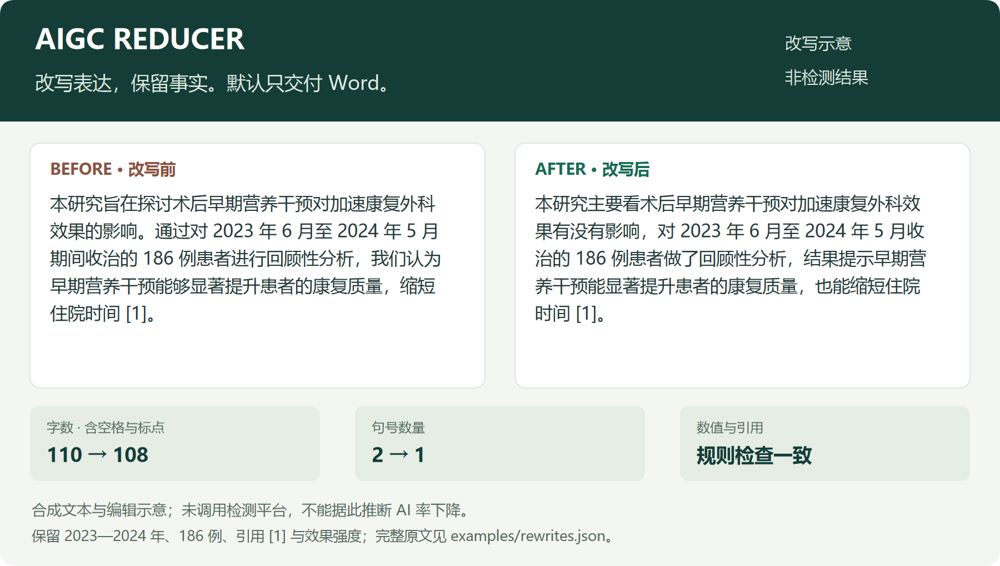

<div align="center">

# AIGC Reducer

### 中文论文表达整改 · 原稿与检测报告进，修改后的 Word 出

[](LICENSE)
[](https://www.python.org/)
[](https://github.com/Longfei-Tao/aigc-reducer/actions/workflows/test.yml)
[](https://agentskills.io/specification)

[快速开始](#快速开始) · [改写示例](#改写示例) · [各工具安装指南](docs/INSTALL.md) · [命令行](docs/CLI.md) · [English](docs/README.en.md)

</div>

把中文论文 `.docx` 和知网、维普、万方等平台的 AIGC 检测报告交给 AI，按既定提示词处理选定正文。脚本负责定位、对齐和回写，模型负责表达改写。

**默认只交付修改后的 Word。** 校验在内部完成，不附审计报告、对照表、自检 JSON 或其他附件。



> 图中是合成文本的编辑示意，指标可核算，未使用检测器测分；不是“AI 率降低”的实测证明。[完整前后文本与说明](examples/README.md)

## 快速开始

### 1. 下载并准备 Python

```bash
git clone https://github.com/Longfei-Tao/aigc-reducer.git
cd aigc-reducer
python -m pip install -r skills/aigc-reducer/requirements.txt
```

需要 Python 3.9+。没有 Git 时，可在 GitHub 的 **Code → Download ZIP** 下载后解压，再进入仓库目录安装依赖。

### 2. 在你使用的 AI 工具里加载技能

技能本体是 `skills/aigc-reducer/` 整个目录，含 `SKILL.md`、脚本、参考文件和许可证。只复制一个 `SKILL.md` 不够。

| 你使用的工具 | 推荐入口 | 详细步骤 |
|---|---|---|
| WorkBuddy | 技能 → 添加技能 → 上传技能包 | [WorkBuddy](docs/INSTALL.md#workbuddy) |
| Claude Code | 安装到 `~/.claude/skills/` | [Claude Code](docs/INSTALL.md#claude-code) |
| Codex | 安装到 `~/.agents/skills/` | [Codex](docs/INSTALL.md#codex) |
| Cursor | `~/.agents/skills/` 或项目 `.cursor/skills/` | [Cursor](docs/INSTALL.md#cursor) |
| Gemini CLI | `~/.agents/skills/` 或 `~/.gemini/skills/` | [Gemini CLI](docs/INSTALL.md#gemini-cli) |
| GitHub Copilot | 个人 `~/.agents/skills/` 或项目 `.github/skills/` | [GitHub Copilot](docs/INSTALL.md#github-copilot) |
| OpenCode | `~/.agents/skills/` 或项目 `.opencode/skills/` | [OpenCode](docs/INSTALL.md#opencode) |
| OpenClaw | 工作区 `skills/` 或 `~/.openclaw/skills/` | [OpenClaw](docs/INSTALL.md#openclaw) |
| 网页版 AI / 不支持技能的客户端 | 本地 CLI + 手动搬运每批文字 | [通用手动流程](docs/INSTALL.md#manual) |

以上入口按官方文档整理，**不表示已在每个客户端实测通过**。原生自动流程需要宿主能读写文件、执行 Python，并能阅读报告；支持一个模型不等于支持这些工具。只有文本对话能力时，走手动流程即可。

CC Switch 用户通过 CC Switch 分发共享技能，不要手工覆盖其生成的客户端副本。

### 3. 给出原稿、报告和一句话要求

把两个文件添加到对话，或给出宿主可以访问的文件路径：

```text
使用 aigc-reducer。原稿是“论文.docx”，检测报告是“检测报告.pdf”。
按报告标记处理对应正文，保留数据、引用和结论含义。
只给我修改后的 Word 文件，不要报告、对照表或其他附件。
```

也可以指定：“只处理第 3 章”“整篇正文润色”或“先改一节让我看看”。报告范围不清或章节有重名时，技能会先明确目标。

## 改写示例

[示例页](examples/README.md) 提供摘要、结果、讨论三组完整前后文本，原始数据见 [rewrites.json](examples/rewrites.json)。它们展示表达如何调整，以及数字、引用、限定条件如何保留。

| 展示的内容 | 当前证据 |
|---|---|
| 文字前后变化 | 公开的合成文本，可逐句比较 |
| 字数、标点、数值与引用 | 从示例原文计算，并通过脚本检查 |
| AIGC 检测分数下降 | 暂无同一检测平台前后报告，不标注分数或降幅 |
| 最终论文语义与版式 | 仍需作者核对，不以标点指标代替人工审阅 |

有可公开的真实案例时，请使用同一检测平台、同一范围，记录日期、平台版本（能获取时）、改写模型与设置，并提供脱敏前后材料。真实检测结果和编辑示意分别展示；不拿模型自评分充当平台检测结果。

## 它与普通改写提示词有什么区别

| 环节 | 本技能的处理 |
|---|---|
| 找到该改哪里 | 根据报告定位到正文段落，章节歧义不自动取第一项 |
| 批量处理长论文 | 分节分批，回复段数不匹配就拒绝写入 |
| 防止改错文档 | 原稿指纹绑定改写结果，来源不一致就拒绝回写 |
| 保护文档结构 | 标题、题注、参考文献、公式和复杂对象默认排除 |
| 防止事实硬伤 | 检查数值、符号、百分号、比较方向及引用编号与次数 |
| 减少交付负担 | 只输出新的 Word，过程文件留在内部临时目录 |


## 使用边界

- **保留原稿，输出新文件。** 不覆盖输入文档，也不覆盖已有目标 Word。
- **保留段落属性，局部格式可能变化。** run 替换可能丢失局部加粗、斜体和上下标；文字长度变化也可能改变分页。表格、页眉页脚、文本框、脚注正文不参与改写，含图片、域、修订等复杂对象的正文排除。
- **本地脚本不联网，宿主模型可能联网。** 未公开或敏感论文需先确认宿主的数据处理方式。
- **不承诺检测分数或语义等价。** 数值检查不能判断全部单位、归因、否定和结论强度，交付前要核对成品。按所在机构要求披露 AI 辅助，不删除依法需要保留的生成内容标识。

默认五条改写指令保存在 [prompt.md](skills/aigc-reducer/references/prompt.md)，batch 自动读取；若要更换风格，用 `--prompt` 指向自己的文件。事实保护优先于风格偏好。

## 常见问题

**网页版 ChatGPT、Claude、Gemini、DeepSeek、豆包、Kimi 等能直接安装吗？**

本项目不假定这些网页产品都支持本地技能或 Python 执行。可以使用同一套改写请求，按[手动流程](docs/INSTALL.md#manual)在本地完成 Word 回写；有可执行环境的产品，按它实际开放的功能操作。

**没有检测报告还能用吗？**

可以，指定章节或整篇正文即可；报告用于确定范围，不是运行脚本的必要条件。扫描 PDF 若宿主无法识别，可提供章节标题、可复制文字或原文片段。

**为什么不给对照表和自检报告？**

默认只交付 Word。需要追溯时由用户明确提出，再用 `write --diff-md` 或 `check -o` 额外导出。

**如何确认安装成功？**

先确认工具已发现 `aigc-reducer`，再用 `make_sample.py` 的合成文档试跑并重新打开输出。看到技能名称不等于 Python 已可运行；[安装指南](docs/INSTALL.md)列出了检查方法。

## 开发、贡献与许可

```bash
python -m unittest discover -s tests -v
```

本地回归覆盖 40 项用例；CI 配置为 Linux / Windows、Python 3.9 / 3.12。实际 CI 状态看顶部徽章；测试通过不代表改写语义或检测效果已经验证。

- [命令行完整参考](docs/CLI.md) · [贡献指南](CONTRIBUTING.md) · [更新记录](CHANGELOG.md)
- [架构与同类技能审查](docs/REVIEW-2026-10-31.md) · [GitHub 展示对比](docs/SHOWCASE.md)
- [开源与法律边界](docs/OPEN_SOURCE_REVIEW.md) · [MIT License](LICENSE)

格式遵循 [Agent Skills](https://agentskills.io/specification)，文档操作依赖 [python-docx](https://github.com/python-openxml/python-docx)。现有代码、提示词及 SVG 的权属由维护者确认；本次展示未复制同类项目的代码、文案或素材。
