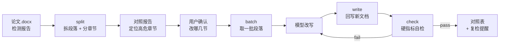

# AIGC Reducer · 论文降 AIGC 率

把一篇论文 Word 和一份 AIGC 检测报告丢进来，输出**「文字被改写、排版原样保留」**的新文档，外加逐段改动对照表和硬指标自检报告。

面向学位论文、期刊投稿稿、开题报告的 AIGC 率整改。

---

## 它解决什么问题

知网、维普等平台的 AIGC 检测会给出一份分节疑似度报告。手动整改有三个麻烦：

1. **挑不准** —— 报告写「3.2 研究方法 78%」，你得自己翻到正文对应段落
2. **改坏版式** —— 复制到别处改写再粘回来，字号、缩进、脚注全乱
3. **改过头** —— 为了降疑似度把数字、引用标记一起改掉，变成学术硬伤

本工具把这三件事拆开：用脚本管**定位**和**回写**，把**遣词**交给模型，最后用脚本做**硬指标自检**。改写只发生在段落内部的文字上，不重建文档，所以样式、表格、图片、页眉页脚都不受影响。

**全程本地处理。** `docx_tool.py` 只依赖 Python 标准库和 `python-docx`，不联网、不读取任何外部配置、不把论文内容发到任何地方。论文和检测报告始终留在你自己的电脑上。

## 它不动什么

| 对象 | 处理方式 |
|---|---|
| 数字、百分比、年份 | 原样保留，丢失会告警 |
| 引用标记 `[1]` | 0 丢失，丢失直接判 `fail` |
| 表格内容 | 不参与改写 |
| 图片、公式 | 不参与改写 |
| 标题、图表题注 | 不参与改写，脚本强制拦截 |
| 参考文献、致谢 | 不参与改写 |
| 段落样式、字体、缩进 | 就地替换 run 文本，样式不动 |
| 脚注 / 尾注 | 引用本身保留，位置可能偏移（会提示） |

**不承诺分数。** 检测器模型持续迭代，本工具保证「严格按既定指令改到位」，不保证「降到某个百分比」。请用同一个检测器、同一口径复检，不同平台的分数不可横向比较。

## 快速开始

### 方式一：作为 WorkBuddy 技能

```bash
git clone https://github.com/Longfei-Tao/aigc-reducer.git
cp -r aigc-reducer/skills/aigc-reducer ~/.workbuddy/skills/
pip install -r ~/.workbuddy/skills/aigc-reducer/requirements.txt
```

Windows PowerShell 把第二行换成：

```powershell
Copy-Item -Recurse aigc-reducer\skills\aigc-reducer "$env:USERPROFILE\.workbuddy\skills\"
```

装完的结构是 `~/.workbuddy/skills/aigc-reducer/`，里面有 `SKILL.md`、`references/`、`scripts/`。**技能目录是自包含的**，不依赖仓库里其他文件，单独拷给别人也能直接用。

然后在对话里说「这两个文件：论文.docx 和知网报告.pdf，帮我降一下 AIGC 率」，技能会自动加载。

### 方式二：直接命令行

需要 Python 3.9+。

```bash
git clone https://github.com/Longfei-Tao/aigc-reducer.git
cd aigc-reducer
pip install python-docx

# 生成一份样例论文，先拿它试手
python skills/aigc-reducer/scripts/make_sample.py -o 样例.docx
```

## 工作流



## 命令参考

四个子命令，串起来就是一条流水线。中间文件统一放 `work/`。

> 以下命令以**论文所在目录**为当前工作目录，`work/` 会生成在论文旁边。脚本用相对仓库根的路径；若已把技能装到 `~/.workbuddy/skills/`，把 `skills/aigc-reducer/scripts/docx_tool.py` 换成该技能的绝对路径即可。

### 1. `split` —— 拆文档

```bash
python skills/aigc-reducer/scripts/docx_tool.py split 论文.docx -o work/blocks.json --batch-chars 1200
```

输出段落清单、章节树、分批方案。看一眼摘要确认三件事：可改写字数、表格数（不参与改写）、分批数。

```
[split] 论文样例.docx
  段落总数      25
  可改写正文     10 段 / 810 字
  标题 / 参考文献 / 公式 / 题注  10 / 4 / 0 / 1
  表格          1 个（37 字，不参与改写）
  分批          7 批（每批 ≤1200 字）
```

### 2. `batch` —— 取一批段落，拼成可直接发送的请求

```bash
# 按批次号
python skills/aigc-reducer/scripts/docx_tool.py batch work/blocks.json --id 3 \
  --prompt skills/aigc-reducer/references/prompt.md -o work/batch3.txt

# 按章节标题（模糊匹配）
python skills/aigc-reducer/scripts/docx_tool.py batch work/blocks.json --section "2.1 研究对象" --prompt skills/aigc-reducer/references/prompt.md

# 直接指定段落 id
python skills/aigc-reducer/scripts/docx_tool.py batch work/blocks.json --ids 8,9,10 --prompt skills/aigc-reducer/references/prompt.md
```

`--prompt` 会把 `references/prompt.md` 里的改写指令原文拼在段落前面，输出**与手工发送完全等价**的请求文本。加 `-o` 存成纯文本，可直接复制粘贴。

不加 `--prompt` 则只输出段落原文。

这一条是为了消灭最常见的翻车方式：手抄段落 id 错一位，标题就被正文覆盖了。`batch` 会拒绝任何非正文段落。

### 3. `write` —— 回写新文档

```bash
python skills/aigc-reducer/scripts/docx_tool.py write 论文.docx work/edits.json \
  -o 论文_降AI版.docx --diff-md work/对照表.md
```

`edits.json` 格式：

```json
{
  "8": "改写后的第一段……",
  "9": "改写后的第二段……"
}
```

**安全校验**（缺一不可）：

- 输出路径与源文件相同 → 直接拒绝，绝不覆盖原稿
- 目标 id 是标题 / 图注 / 参考文献 / 公式 → 拒绝并列出，需 `--allow-non-para` 才放行
- 段落含超链接 → 默认跳过（改写会让链接文字重复），需 `--force`

会把 `[跳过]` / `[提示]` / `[警告]` 三类信息如实打印，包括局部加粗丢失、脚注位置偏移。

### 4. `check` —— 硬指标自检

```bash
python skills/aigc-reducer/scripts/docx_tool.py check 论文.docx work/edits.json -o work/check.json
```

| 指标 | 合格线 | 不达标 |
|---|---|---|
| 全篇字数变化 | ±10% 内 | warn |
| 句号数量 | 减少 ≥20% | warn |
| 逗号数量 | 必须增加 | warn |
| 引用标记 `[n]` | 0 丢失 | **fail** |
| 数字 / 百分比 | 0 丢失 | warn |
| 「我觉得 / 我认为」 | 0 残留 | **fail** |

`verdict` 分三档：`pass` / `warn`（可交付但需说明）/ `fail`（必须修）。

`fail` 时先修问题段再重新回写，不要带着已知问题交付。

## 为什么改写能保住排版

常见做法是把段落文字复制出去改写，再整段粘贴回来 —— 粘贴动作会重置 run 级格式，段内的加粗、斜体、上下标全丢。

本工具直接操作 Word 的 XML：定位段落后，把新文字写进段内**第一个可编辑 run**，其余 run 清空。段落属性（`pPr`）、样式、缩进、行距、编号都不经过手，所以原样不动。

代价是**段内局部格式无法保留**（比如一句话里有三个字加粗），`write` 会把这类段落列出来告诉你。

## 换成你自己的改写指令

`references/prompt.md` 是默认指令，**不是硬编码**。想换成你习惯的写法，直接编辑这个文件，代码一行都不用动。

规则只有一条：文件里第一个 `---` 分隔线之后的内容会被整段取用，所以「修改段落:」要留在最后一行。`batch --prompt` 会原样拼接，不做任何加工、不增删一个字。

同理，`references/report-parsing.md` 是检测报告的解析策略（章节名怎么匹配、匹配不上怎么降级），换平台时按实际情况调整即可。

## 目录结构

```
aigc-reducer/
├── README.md
├── LICENSE
└── skills/aigc-reducer/            # 技能本体，整个目录拷到 ~/.workbuddy/skills/ 即可自包含运行
    ├── SKILL.md                    # 给模型看的操作手册
    ├── requirements.txt
    ├── references/
    │   ├── prompt.md               # 改写指令（唯一来源，逐字执行）
    │   └── report-parsing.md       # 检测报告解析与章节定位
    └── scripts/
        ├── docx_tool.py            # 四件套：split / batch / write / check
        └── make_sample.py          # 生成样例论文，用于试跑与回归
```

## 常见坑

1. **`.doc` 旧格式** —— python-docx 打不开，先用 Word「另存为」`.docx`
2. **段落 id 错位** —— 不要手抄 id，用 `batch` 或从 `blocks.json` 的 `blocks[].id` 取
3. **改写后字数暴涨** —— 通常是模型自行扩写，重跑该批并强调「不得增加原文没有的信息」
4. **短文档批次数偏多** —— 遇标题强制断批，810 字的小论文也可能会分出 7 批，属正常
5. **报告章节名与正文标题不一致** —— 报告写「3.2 研究方法」，正文写「3.2 研究方法与数据来源」，用模糊匹配，匹配不上让用户点
6. **超过 5 万字的文档** —— 先只跑一节给用户看效果，认可后再继续，避免全量返工
7. **自动编号的章节标题** —— Word 里是域，`p.text` 可能读不到编号，匹配以标题文字为主

## 关于学术诚信

这个工具的定位是**表达层整改**，不是内容生产。

- 它不改数据、不改结论、不添加原文没有的信息
- 它不会把别人的内容变成你的
- 它不保证绕过任何检测系统

如果你用 AI 参与了写作，正确做法是按所在学校 / 期刊的规定如实声明。**使用者对学术诚信负全部责任。**

工具会在交付时明确提醒复检，不承诺分数，这是设计上的刻意选择。

## License

MIT
