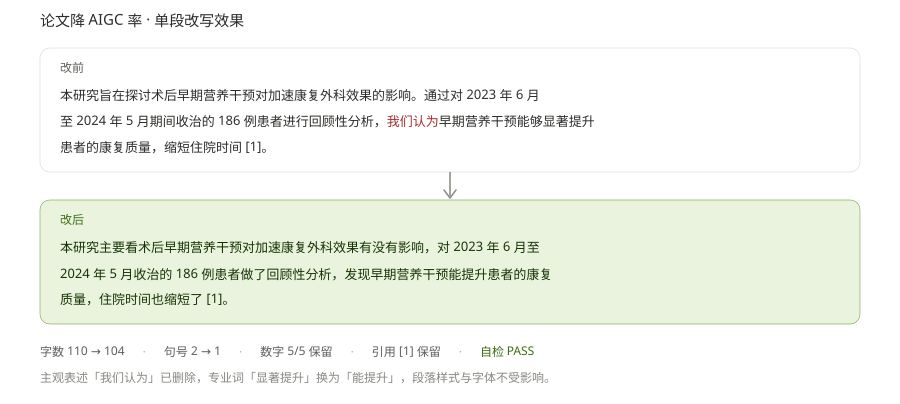
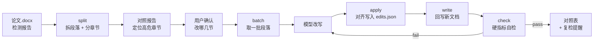

# AIGC Reducer · 论文降 AIGC 率

[](LICENSE)
[](https://www.python.org/)
[](https://github.com/anthropics/skills)

**给中文论文做「表达层整改」：只换文字，样式、数据、引用一个字不动。**

Rewrite the wording of Chinese academic papers to lower AIGC-detection scores — while every style, table, number and citation stays exactly where it was.



## 目录

- [它解决什么问题](#它解决什么问题)
- [它不动什么](#它不动什么)
- [改写指令](#改写指令)
- [安装](#安装)
- [工作流](#工作流)
- [命令参考](#命令参考)
- [为什么能保住排版](#为什么能保住排版)
- [换成你自己的指令](#换成你自己的指令)
- [目录结构](#目录结构)
- [常见问题](#常见问题)
- [贡献](#贡献)
- [关于学术诚信](#关于学术诚信)

## 它解决什么问题

知网、维普等平台的 AIGC 检测会给出一份分节疑似度报告。手动整改有三个麻烦：

1. **挑不准** —— 报告写「3.2 研究方法 78%」，你得自己翻到正文对应段落
2. **改坏版式** —— 复制到别处改写再粘回来，字号、缩进、脚注全乱
3. **改过头** —— 为了降疑似度把数字、引用标记一起改掉，变成学术硬伤

本工具把这三件事拆开：脚本管**定位**和**回写**，模型管**遣词**，最后用脚本做**硬指标自检**。改写只发生在段落内部的文字上，不重建文档，所以样式、表格、图片、页眉页脚都不受影响。

**全程本地处理。** `docx_tool.py` 只依赖 Python 标准库和 `python-docx`，不联网、不读取外部配置、不把论文内容发到任何地方。论文和检测报告始终留在你自己的电脑上。

## 它不动什么

| 对象 | 处理方式 |
|---|---|
| 数字、百分比、年份 | 原样保留，丢失会告警 |
| 引用标记 `[1]` | 0 丢失，丢失直接判 `fail` |
| 表格内容 | 不参与改写 |
| 图片、公式 | 不参与改写 |
| 标题、图表题注 | 不参与改写，脚本强制拦截 |
| 参考文献、致谢 | 不参与改写 |
| 段落样式、字体、缩进 | 就地替换 run 文本，样式不动 |
| 页眉、页脚、文本框、脚注正文 | 不参与改写，也不报警 |
| 脚注 / 尾注 | 引用本身保留，位置可能偏移（会提示） |

**不承诺分数。** 检测器模型持续迭代，本工具保证「严格按既定指令改到位」，不保证「降到某个百分比」。请用同一个检测器、同一口径复检，不同平台的分数不可横向比较。

## 改写指令

`references/prompt.md` 里是五条改写指令，**这是整个技能的核心资产**——经过人工调参、实测有效的措辞，不是通用模板。

```
指令:1. 在不大幅改动原文总字数的情况下，只调整语序、替换同义词、变换主谓宾结构，
        补充那些无主语句的主语，语言简化，让语句有逻辑且通顺，贴合基础论文写作规范。
     2. 弱化专业感，要营造作者写起来很吃力、勉强写完了的普通文笔效果，
        删除"我觉得、我认为"这些主观表述，整体文笔平实普通。
     3. 弱化语句精炼度，贴合新手写作状态。
     4. 减少句号使用，多用逗号、分号衔接；将长句拆分成短句，高频词换同义词，
        专业词汇替换为通俗简单表达。
     5. 打乱句子原有结构，灵活互换，把字句、被动句，调整语句语序，
        不改变原文核心表意。删除过于口水话的口语化表达，保持基本语言逻辑,严格执行
修改段落:
<这一批的段落原文>
```

`batch` 命令会把这段指令**原样**贴在段落前面，一个字不改。

`SKILL.md` 里为此写死了四条禁令：不许凭记忆复述指令、不许概括精简、不许自行追加「保持学术严谨性」之类的反向约束、不许「优化」它让更清晰。**它不需要被优化。**

> 想换成自己的写法，见[换成你自己的指令](#换成你自己的指令)，代码一行都不用动。

## 安装

需要 Python 3.9+ 和 `python-docx`。

### 方式一：装成 Agent 技能（推荐）

适用于支持 [Agent Skills](https://github.com/anthropics/skills) 开放标准的工具，包括 WorkBuddy、Claude Code 等。

```bash
git clone https://github.com/Longfei-Tao/aigc-reducer.git
cp -r aigc-reducer/skills/aigc-reducer ~/.workbuddy/skills/
pip install -r ~/.workbuddy/skills/aigc-reducer/requirements.txt
```

Windows PowerShell 把第二行换成：

```powershell
Copy-Item -Recurse aigc-reducer\skills\aigc-reducer "$env:USERPROFILE\.workbuddy\skills\"
```

Claude Code 用户把路径换成 `~/.claude/skills/` 即可，目录结构完全一致。

装完的结构是 `~/.workbuddy/skills/aigc-reducer/`，里面有 `SKILL.md`、`references/`、`scripts/`。**技能目录是自包含的**，不依赖仓库里其他文件，单独拷给别人也能直接用。

然后在对话里说「这两个文件：论文.docx 和知网报告.pdf，帮我降一下 AIGC 率」，技能会自动加载。

### 方式二：只用命令行

不装任何 Agent 也能用，但要手动搬文本（见[常见问题](#常见问题)第 3 条）。

```bash
git clone https://github.com/Longfei-Tao/aigc-reducer.git
cd aigc-reducer
pip install python-docx

# 生成一份样例论文，先拿它试手
python skills/aigc-reducer/scripts/make_sample.py -o 样例.docx
```

## 工作流



## 命令参考

六个子命令，串起来就是一条流水线。中间文件统一放 `work/`。

> 以下命令以**论文所在目录**为当前工作目录，`work/` 会生成在论文旁边。脚本用相对仓库根的路径；若已把技能装到 `~/.workbuddy/skills/`，把 `skills/aigc-reducer/scripts/docx_tool.py` 换成该技能的绝对路径即可。

### 1. `split` —— 拆文档

```bash
python skills/aigc-reducer/scripts/docx_tool.py split 论文.docx -o work/blocks.json --batch-chars 1200
```

输出段落清单、章节树、分批方案。看一眼摘要确认三件事：可改写字数、表格数（不参与改写）、分批数。

```
[split] 论文样例.docx
  段落总数      25
  可改写正文     10 段 / 810 字
  标题 / 参考文献 / 公式 / 题注  10 / 4 / 0 / 1
  表格          1 个（37 字，不参与改写）
  分批          7 批（每批 ≤1200 字）
```

### 2. `batch` —— 取一批段落，拼成可直接发送的请求

```bash
# 按批次号
python skills/aigc-reducer/scripts/docx_tool.py batch work/blocks.json --id 3 \
  --prompt skills/aigc-reducer/references/prompt.md -o work/batch3.txt

# 按章节标题（模糊匹配）
python skills/aigc-reducer/scripts/docx_tool.py batch work/blocks.json \
  --section "2.1 研究对象" --prompt skills/aigc-reducer/references/prompt.md

# 直接指定段落 id
python skills/aigc-reducer/scripts/docx_tool.py batch work/blocks.json \
  --ids 8,9,10 --prompt skills/aigc-reducer/references/prompt.md
```

`--prompt` 会把改写指令原文拼在段落前面，输出**与手工发送完全等价**的请求文本。加 `-o` 存成纯文本，可直接复制粘贴。

这一条是为了消灭最常见的翻车方式：手抄段落 id 错一位，标题就被正文覆盖了。`batch` 会拒绝任何非正文段落。

### 3. `apply` —— 把模型回复写回结果

```bash
# 把模型的回复存成 reply_3.txt（段落之间空一行），再对齐
python skills/aigc-reducer/scripts/docx_tool.py apply work/blocks.json --batch 3 \
  --input work/reply_3.txt -o work/edits.json --progress work/progress.json
```

按空行切分回复，**块数与本批段落数不相等就拒绝写入**，并列出期望 id 与实际块数。`edits.json` 累积写入，`progress.json` 自动回填。回复被 ``` 代码围栏包住时会自动剥掉；段落编号前缀（`1.` `（1）`）加 `--strip-number` 去掉。

这一步消灭了最常见的翻车方式：模型返回 3 段而本批是 4 段，靠人眼对序号，结果把下一节的**标题**当成正文覆盖掉。

### 4. `status` —— 看进度，中断后续跑

```bash
python skills/aigc-reducer/scripts/docx_tool.py status work/blocks.json
```

逐批列出「完成 / 部分 / 未开始」和下一批的批次号，不用自己翻 `progress.json`。

### 5. `write` —— 回写新文档

```bash
python skills/aigc-reducer/scripts/docx_tool.py write 论文.docx work/edits.json \
  -o 论文_降AI版.docx --diff-md work/对照表.md
```

`edits.json` 格式：

```json
{
  "8": "改写后的第一段……",
  "9": "改写后的第二段……"
}
```

**安全校验**（缺一不可）：

- 输出路径与源文件相同 → 直接拒绝，绝不覆盖原稿
- 目标 id 是标题 / 图注 / 参考文献 / 公式 → 拒绝并列出，需 `--allow-non-para` 才放行
- 段落含超链接 → 默认跳过（改写会让链接文字重复），需 `--force`

会把 `[跳过]` / `[提示]` / `[警告]` 三类信息如实打印，包括局部加粗丢失、脚注位置偏移。

### 6. `check` —— 硬指标自检

```bash
python skills/aigc-reducer/scripts/docx_tool.py check 论文.docx work/edits.json -o work/check.json
```

| 指标 | 合格线 | 不达标 |
|---|---|---|
| 全篇字数变化 | ±10% 内 | warn |
| 句号数量 | 减少 ≥20% | warn |
| 逗号数量 | 必须增加 | warn |
| 引用标记 `[n]` | 0 丢失 | **fail** |
| 数字 / 百分比 | 0 丢失 | warn |
| 「我觉得 / 我认为」 | 0 残留 | **fail** |
| 指令回显（含「修改段落」字样） | 0 段 | **fail**，重新生成该批 |

引用标记只认方括号写法 `[1]`、`[2-4]`（GB/T 7714）；中文论文里的年份括注「（2021）」不作引用计。含超链接的段落 `write` 会跳过，`check` 同样不计入指标，保证自检数字与成品一致。

`verdict` 分三档：`pass` / `warn`（可交付但需说明）/ `fail`（必须修）。

`fail` 时先修问题段再重新回写，不要带着已知问题交付。

## 为什么能保住排版

常见做法是把段落文字复制出去改写，再整段粘贴回来 —— 粘贴动作会重置 run 级格式，段内的加粗、斜体、上下标全丢。

本工具直接操作 Word 的 XML：定位段落后，把新文字写进段内**第一个可编辑 run**，其余 run 清空。段落属性（`pPr`）、样式、缩进、行距、编号都不经过手，所以原样不动。

代价是**段内局部格式无法保留**（比如一句话里有三个字加粗），`write` 会把这类段落列出来告诉你。

## 换成你自己的指令

`references/prompt.md` 是默认指令，**不是硬编码**。想换成你习惯的写法，直接编辑这个文件，代码一行都不用动。

规则只有一条：文件里第一个 `---` 分隔线之后的内容会被整段取用，所以「修改段落:」要留在最后一行。`batch --prompt` 会原样拼接，不做任何加工、不增删一个字。

同理，`references/report-parsing.md` 是检测报告的解析策略（章节名怎么匹配、匹配不上怎么降级），换平台时按实际情况调整即可。

## 目录结构

```
aigc-reducer/
├── README.md
├── CHANGELOG.md
├── CONTRIBUTING.md
├── LICENSE
├── assets/
│   └── demo.svg                    # 效果示意图
├── tests/
│   └── test_pipeline.py            # 回归测试：分类 / 对齐 / 拦截 / 自检（python -m unittest）
├── .github/workflows/test.yml      # CI：Linux + Windows、Python 3.9/3.12
└── skills/aigc-reducer/            # 技能本体，整个目录拷到 ~/.workbuddy/skills/ 即可自包含运行
    ├── SKILL.md                    # 给模型看的操作手册
    ├── requirements.txt
    ├── references/
    │   ├── prompt.md               # 改写指令（唯一来源，逐字执行）
    │   └── report-parsing.md       # 检测报告解析与章节定位
    └── scripts/
        ├── docx_tool.py            # 六件套：split / batch / apply / status / write / check
        └── make_sample.py          # 生成样例论文，用于试跑与回归
```

## 常见问题

**1. 支持 `.doc` 和 PDF 吗？**

不支持。`python-docx` 只认 `.docx`。请用 Word 打开后「另存为」一份 `.docx`，转换过程不改内容。

**2. 能保证降到多少分？**

不能，也不承诺。检测器模型持续迭代，同一个工具在不同平台、不同时间的结果都不一样。本工具保证的是「严格按指令改到位、硬指标不退化」，分数请拿回原平台复检。

**3. 没有 WorkBuddy / Claude Code，能用吗？**

能，但是半自动：跑 `split` 拆文档，跑 `batch --id N` 生成请求文本，手动粘给网页版 AI，把回复存成纯文本，跑 `apply --batch N` 写回结果，再跑 `write` 和 `check`。定位、对齐、保格式、自检都还是脚本干的，只是搬文本要手动。`apply` 会核对段数，段落之间记得空一行。

**4. 批次数为什么这么多？**

遇标题强制断批，不跨节混改，方便按节核对。800 字的小论文也可能分出 7 批，属正常。

**5. 改完打开文档发现某段加粗没了？**

那一段内部原本有局部加粗。`write` 会把这类段落 id 列出来，需要手工补。这是「就地替换 run 文本」这一策略的已知代价。

**6. 脚注跑位了？**

引用本身不会丢，但位置可能随语句调整而偏移。`write` 会列出含脚注引用的段落，交付前建议核对。

**7. 页眉、页脚、文本框里的文字改了吗？**

没有。这些位置不在 Word 的段落列表里，本工具不碰、也不报警。若检测报告标红的正是页眉或文本框内容，需要手工处理。

**8. `apply` 报「段数对不上」怎么办？**

模型把两段并成一段，或回复里多带了说明文字。重新生成该批即可；确要手工拼接时，按空行把段落分开（本批几段就切几块），再跑一遍 `apply`。它拒绝写入时不会留下半成品。

## 贡献

欢迎提 Issue 和 PR，尤其是：

- 适配其他检测平台的报告格式（扩充 `references/report-parsing.md`）
- 新增硬指标检查项（比如术语一致性、被动句比例）
- 补充不同学科语料的回归测试

提交前请跑一遍样例回归，确认 `check` 仍为 `PASS`。详见 [CONTRIBUTING.md](CONTRIBUTING.md)。

## 关于学术诚信

这个工具的定位是**表达层整改**，不是内容生产。

- 它不改数据、不改结论、不添加原文没有的信息
- 它不会把别人的内容变成你的
- 它不保证绕过任何检测系统

如果你用 AI 参与了写作，正确做法是按所在学校 / 期刊的规定如实声明。**使用者对学术诚信负全部责任。**

工具会在交付时明确提醒复检，不承诺分数，这是设计上的刻意选择。

## License

[MIT](LICENSE)

## 致谢

- 技能格式遵循 Anthropic 发布的 [Agent Skills](https://github.com/anthropics/skills) 开放标准
- Word 读写依赖 [python-docx](https://github.com/python-openxml/python-docx)
- 改写指令来自实际投稿整改中的反复调参，非通用模板
