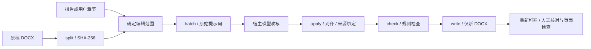

# AIGC Reducer 开发审查

审查日期：2026-10-31。更新：1.3.1 默认只交付修改后的 Word，报告/对照表改为用户明确要求时导出；校验和过程记录用于内部。基线：89f6c04。覆盖所有 Git 跟踪源码、技能入口、两个参考文件、依赖声明、测试、CI、演示 SVG、许可和贡献说明；不读取被忽略的私人论文或本地工作区数据。

## 判断

架构分工合理，适合继续维护为半自动文档表达编辑技能。项目的差异化在于“报告定位 + 段落对齐 + Word 回写 + 可追溯对照”，单独的五条提示词与其他改写技能重合较多。当前不能承诺语义严格不变、版式完全相同或检测率下降；规则检查和文档结构检查不等于科研事实审查。

无需立刻拆成多个 Python 包。保留自包含技能和单文件 CLI，优先维护来源绑定、选择范围、不可改对象、成品校验四个契约。报告阅读、模型编辑和视觉验收依赖宿主，脚本没有提供这些能力。

## 数据流与使用方法

1. 安装 requirements.txt，先用 make_sample.py 生成合成样例。
2. 每篇论文建独立目录，split 后不要编辑原稿。PDF 报告由宿主读取；没有 PDF/OCR 工具时按用户指定章节处理。
3. 根据 sections/batches 确定范围。sections 是直接正文的平面列表，不自动包含子章节；遇到同名或多项模糊匹配要用批号或 id。
4. batch 生成请求，宿主执行改写；回复按原顺序、段间空一行。apply 拒绝数量不符，但无法发现相同数量的段落互换。
5. check 检查 edits；fail 修复后再 write。write/check 带 --blocks 可额外核对来源，新版 apply 的 edits 也自带源指纹。
6. 重新打开成品核对正文、关键数据、引用、未修改内容及页面。默认只交付 DOCX，必要校验在内部完成。具体单行命令见 [SKILL.md](../skills/aigc-reducer/SKILL.md)。

中断后用 status 指向同一 blocks 和 edits。完成状态仅表示改写记录存在，不表示质量通过。旧无指纹 edits 仍兼容读取，但不可与新版 apply 混合累积，应另建目录重新处理。

## 已发现并修复

| 严重度 | 基线问题 | 本次处理 |
|---|---|---|
| P1 | --diff-md 可指向原稿并覆盖；其他命令输出也可能覆盖输入 | 集中检查显式输入、blocks 记录的原稿与输出及多个输出别名；write 拒绝已有目标 DOCX |
| P1 | split 后插入正文，旧整数 id 会改错另一段正文 | blocks 与 apply 结果保存 SHA-256；apply/write/check 校验来源，新版 edits 防止跨论文套用 |
| P1 | 带文字的图片、域、对象 run 被 text 赋值清除 | 复杂 XML 段落排除，write 不允许通用强制开关绕过 |
| P1 | 脚注与文字同 run，旧文字与新文字重复 | 混合脚注 run 归入复杂对象；独立引用仍保留并提示位置风险 |
| P1 | 同号引用少一次不报警；新增引用不查 | Counter 比较每段引用编号与次数，新增和缺失均 fail |
| P1 | 30%→30、-5→5、P<0.05→P>0.05 漏检 | 增加数值 token 检查，百分号、符号、比较方向、次数变化 fail |
| P2 | 正文提到“参考文献”导致后续全部排除 | 移除短正文包含关键词即切换模式的逻辑；裸参考文献标题受保护 |
| P2 | 章节匹配多项自动取第一项 | 歧义报错，要求批号或明确 id |
| P2 | --strip-number 破坏小数开头 | 不将小数点作为编号分隔符 |
| P2 | 重复 --ids 静默覆盖 | batch/apply 拒绝重复 id |
| P2 | check fail 仍退出 0 | 退出 1，pass/warn 退出 0；报告仅显式 -o 时导出 |
| P2 | JSON 写入中断会截断已有结果 | 同目录临时文件 + os.replace 原子替换；这不是跨文件事务 |
| P2 | 技能非标准顶层元数据、发布目录不含许可 | version/display_name 移入 metadata；技能自带 MIT LICENSE |
| P2 | 宣传保证全本地、保全部样式、默认提示词实测有效 | 明确宿主数据边界、局部格式和分页限制、缺少效果基准 |

## 尚存限制与后续优先级

- **成品检查自动化**：check 仍只看原稿 + edits。下一步可加显式成品参数，对照最终段落文字、未改 XML、资源关系及关键对象数量；再结合 Word/LibreOffice 页面渲染。此次技能要求人工重开核对，不声称已有完整成品验证器。
- **语义检查**：单位、数字之间的归属、否定、相关与因果、统计结论强度、引用所支撑的主张仍需人工复核。数值 token 相等不证明事实未变；全角数字、千位分隔、复杂数学写法不是完整语法解析器。
- **回复协议**：空行只保证数量。后续可使用带 id 和原文摘要的 JSON 回复，拒绝未知/重复/缺失 id，保留人工复核。仍不可把模型返回的 id 当成可信来源。
- **分类与范围**：自动目录、自定义标题样式、继承 outlineLevel、复杂附录编号可能识别不全；检测报告解析是自然语言策略，未实现完整 OCR/归一化程序。应以明确批次和人工确认兜底。
- **并发与异常输入**：不支持多个进程共享同一工作目录。edits/progress 无跨文件事务，progress 可滞后；畸形 blocks、重复 JSON 键、恶意超大 ZIP/XML 的资源限制尚未全面加固。工具适用于可信本地文件，不应直接暴露为公开上传服务。
- **许可与效果**：维护者已确认原有内容原创或有 MIT 发布授权；没有进行全网抄袭鉴定或专业法律意见。未测试任何真实论文、商业检测服务或真实模型效果。

## GitHub 同类对比

以下为 2026-10-31 在线查看作者仓库所得，分支会变化；只借鉴工作流原则，未引入其代码或提示词，也未做速度或检测率基准。

| 项目 | 与本项目的共同点 | 值得借鉴 | 不宜照搬 |
|---|---|---|---|
| [blader/humanizer](https://github.com/blader/humanizer) | 模型编辑已有文字，识别模板化表达 | 先识别问题、再改写、对照原信息复核；保留作者声音；把输入当材料 | 规则命中不是 AI 来源证明；英文文体线索不能机械套到中文论文 |
| [op7418/Humanizer-zh](https://github.com/op7418/Humanizer-zh) | 中文文本自然化、避免新增事实 | 明确语义优先级，保留条件、范围、否定和确定程度；无问题时允许不改 | 不宜把例子扩成词汇黑名单；它并不提供本项目的 Word 回写流水线 |
| [anthropics/skills 的 docx](https://github.com/anthropics/skills/tree/main/skills/docx) | 文档操作、产物检查 | 学习结构检查和视觉验收的工程原则，自行实现 | 该目录许可证有专有使用限制，不能因为仓库公开就复制到 MIT 项目 |
| [Agent Skills 规范](https://agentskills.io/specification) | SKILL.md + references/scripts 渐进加载 | 标准元数据、简短入口、按需读取参考文档 | 规范兼容不代表每个宿主的工具和发现路径均已实测 |

humanizer 与 Humanizer-zh 根许可为 MIT；大段代码或提示词实质复制需保留相应许可/版权声明，嵌入内容仍须查其来源。许可证核验细节见 [开源审查](OPEN_SOURCE_REVIEW.md)。

## 验证范围

基线 21 项通过，本次扩展到 38 项并全部通过（含重新打开成品的端到端用例）。危险输入用例先在旧实现复现失败，再修复并运行全套。新增覆盖路径别名、源稿变化、跨文档 edits、混合图片/域/脚注、参考文献边界、重复引用、符号与百分号、匹配歧义和小数保护。

独立审查者还进行了三个静态技能场景检查：恶意报告指令、同名章节、split 后原稿改变。静态推演不能代替真实模型服从率测试，也不用于估计检测效果。

开发建议分两条线推进：先补成品验证、结构化回复和输入验证，再做获授权合成语料的多次模型对照与人工语义评价。记录模型版本、提示词摘要、语料授权、语义缺陷和格式缺陷；检测分数只作为附加观察，不能替代作者责任。

附加检查：技能 quick_validate 通过；Python 3.9 语法解析通过（不是 3.9 实机测试）；本地 Markdown 链接检查通过；默认 prompt 文件逐字节未改；演示图字数标注已校正。当前/新增文件的常见密钥模式未命中，未对全部 Git 历史做秘密扫描。没有运行远端 CI 或 Word 页面渲染。
